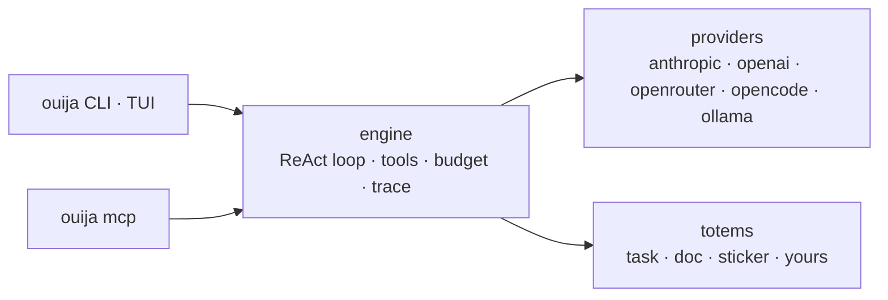
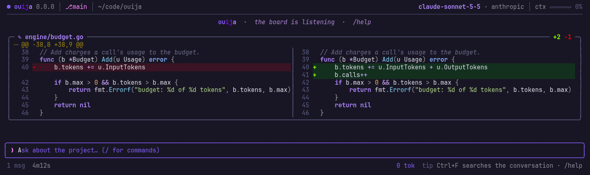

<p align="center">
  
</p>

<p align="center">
  <a href="https://github.com/discorgento/ouija/actions/workflows/ci.yml"></a>
  <a href="https://github.com/discorgento/ouija/releases"></a>
  <a href="https://go.dev/"></a>
  <a href="LICENSE"></a>
</p>

# ouija

An AI harness for **agents you write in Go** — a shared engine (providers,
sandbox, cost budget, tracing, MCP export) under **totems** you own: real code
with types, tests and golden files, not prompt files.

<p align="center">
  
</p>

> **Why not a prompt file?** "Do A, then verify B, then reconcile" written in
> prose is a request the model may skip; in Go it is the next line — and you can
> test it. [The full argument →](docs/explanation/totems.md)

It ships with three totems (`task`, `doc`, `sticker`) — and the engine is a Go
library: **your own agent is a Go type in your repo**, ~20 lines, inheriting
budget, sandbox, tracing and MCP. `go build` gives you a standalone binary.
[Write your own agent →](#write-your-own-agent)

The metaphor is literal: a ouija board needs several hands to spell an answer —
like the N independent passes + reconcile in the `task` totem.



The engine knows nothing about tasks or documents — every totem defines its own
flow on top. See [Architecture](docs/explanation/architecture.md).

## Quick start

```sh
git clone https://github.com/discorgento/ouija.git
cd ouija
make install        # builds ouija + ouija-mcp into $GOBIN
ouija setup         # API keys + default provider/model (~/.config/ouija/config.json, 0600)
```

Then, inside any project:

```sh
cd /path/to/your/project
ouija chat                 # daily driver: explore and edit code, approve diffs
ouija task "describe X"    # one-shot: verified plan (scout → N passes → reconcile)
```

`ouija setup` walks you through the keys; pick `ollama` to run fully local and
free. Diagnose anything with `ouija doctor`. On a terminal, bare `ouija` opens
the chat (and runs the setup the first time).

## The chat

<p align="center">
  
</p>

Each reply says what it did: the turn's tools on one line (a failed command
shows its last lines), the time, tokens and cost — and every file change as a
diff, side by side on a wide terminal. `@file` attaches a file, `/undo` takes a
change back, `Ctrl+F` searches, `ouija chat -c` resumes the last conversation.

<p align="center">
  
</p>

The totems run right in the chat: `/task "add a cache"` draws the séance live —
the scout, every independent pass, the reconcile — and ends on the plan.

<p align="center">
  
</p>

<p align="center">
  
</p>

Keys, commands and themes: [Chat TUI](docs/how-to/chat.md) ·
[CLI reference](docs/reference/cli.md).

## Commands

| Command | What it does |
|---|---|
| `ouija task "..."` | Verified implementation plan: scout → N passes → reconcile → checklist |
| `ouija doc "..."` | Code-verified client document — HTML + PDF + technical MD |
| `ouija sticker` | Laptop sticker SVG from real project metrics |
| `ouija chat` | Interactive terminal chat (Bubble Tea TUI): tools, streaming, approvals |
| `ouija setup` / `ouija init` | Global defaults / per-project config |
| `ouija trust` | Apply a project config you did not write (permissions, allowlist, apiKey, systemPrompt, projectRoot) |
| `ouija learn "fact"` | Save project knowledge, used by the chat and the `task` totem |
| `ouija mcp [install\|status]` | Serve MCP over stdio, or register ouija with your editor's harness |
| `ouija generate totem` | Scaffold a new totem |
| `ouija doctor` | Diagnose config, provider key, and harness wiring |
| `ouija config` | Same wizard as `ouija setup` |
| `ouija version` | Print the version |

Flags, slash commands, shortcuts and exit codes:
[CLI reference](docs/reference/cli.md).

## Write your own agent

A totem is a Go type in **your** repository. `engine`, `registry`, `schema` and
`bootstrap` are public Go packages — no fork, no upstream rebuild:

```go
// github.com/you/your-agents/totems/sentinel/sentinel.go — the whole agent
package sentinel

import (
    "context"

    "github.com/discorgento/ouija/engine"
    "github.com/discorgento/ouija/registry"
)

type Totem struct{}

func (t *Totem) Name() string    { return "sentinel" }
func (t *Totem) Summary() string { return "Example external totem" }
func (t *Totem) Run(ctx context.Context, eng *engine.Engine, args registry.Args) (any, error) {
    res, err := eng.Run(ctx, engine.RunRequest{Label: "sentinel", Prompt: args.Task})
    if err != nil {
        return nil, err
    }
    return map[string]string{"summary": res.Text}, nil
}

func init() { registry.Register(&Totem{}) }
```

`bootstrap.Main` is the whole host — the command line, the MCP server, and the
same config the ouija CLI uses (keys and default provider/model from the global
`~/.config/ouija/config.json`; budget, rules and the rest from the project's
`.ouija/config.json`):

```go
// github.com/you/your-agents/cmd/my-totem/main.go — the whole host
package main

import (
    "os"

    "github.com/discorgento/ouija/bootstrap"
    _ "github.com/you/your-agents/totems/sentinel"
)

func main() { os.Exit(bootstrap.Main(bootstrap.WithName("my-totem"))) }
```

```sh
go build -o my-totem ./cmd/my-totem   # standalone binary, full engine behind it
my-totem sentinel "audit the auth flow" --set depth=2   # typed inputs, see InputSchema
my-totem mcp                          # your totems as my-totem_<name> tools in
                                      # Claude Code, Cursor or OpenCode
```

Walkthrough: [Add a totem](docs/how-to/add-totem.md) · Design rationale:
[Totems](docs/explanation/totems.md).

## Install

From a checkout:

```sh
make install        # both binaries → $GOBIN
```

Without `make`: `go install ./cmd/ouija` (and `./cmd/ouija-mcp`). Both land in
`$(go env GOBIN)` — or `$(go env GOPATH)/bin` when `GOBIN` is unset — which must
be on your `PATH`. Full details, including `PATH` per shell and the
`@latest` caveat: [Install](docs/how-to/install.md).

### Requirements

- **Go 1.26+** (uses `iter.Seq2`, `log/slog`, `slices`, `errors.Join`, `clear`,
  `range-over-int`). Runtime dependencies live in `go.mod` — the Charm stack
  (Bubble Tea v2, Bubbles, Lip Gloss, Glamour, Huh), `mvdan.cc/sh/v3`,
  `charmbracelet/x/ansi`, `atotto/clipboard`, `golang.org/x/sync`; everything
  else is the standard library.
- At least one provider configured via `ouija setup`.

## Development

```sh
make build          # ./ouija + ./ouija-mcp (gitignored)
make run ARGS='…'   # build + execute
make check          # gofmt + go vet + go test — run before committing
make help           # every target
make dist           # cross-compile 5 targets → dist/*.tar.gz
```

The version comes from the **git tag** — created automatically by the release
pipeline — and is injected at link time, feeding the CLI, the MCP `serverInfo`
and the TUI header from one source. Never edit a version by hand; pass an
explicit one only for testing (`make build VERSION=vX.Y.Z`).

CI runs the same gate on every push and PR (gofmt, vet, `go test -race ./...`,
build). Full workflow and code conventions:
[Contribute](docs/how-to/contribute.md).

Releases are automated: pushing to `main` opens a *release PR* (version bump +
changelog), merging it creates the tag `vX.Y.Z` and the GitHub Release with the
cross-compiled archives attached — no manual versioning, ever. Details:
[Releases](docs/how-to/contribute.md#releases).

## Documentation

Full documentation in [`docs/`](docs/index.md):

| Tutorial | How-to | Reference | Explanation |
|---|---|---|---|
| [Getting started](docs/tutorial/getting-started.md) | [Install](docs/how-to/install.md) | [CLI](docs/reference/cli.md) | [Totems](docs/explanation/totems.md) |
| | [Configure](docs/how-to/configure.md) | [Config schema](docs/reference/config-schema.md) | [Architecture](docs/explanation/architecture.md) |
| | [Run a totem](docs/how-to/run-totems.md) | [Environment](docs/reference/environment.md) | [Engine](docs/explanation/engine.md) |
| | [Chat TUI](docs/how-to/chat.md) | [Trace schema](docs/reference/trace-schema.md) | [Security](docs/explanation/security.md) |
| | [MCP](docs/how-to/integrate-mcp.md) | | |
| | [Add a totem](docs/how-to/add-totem.md) | | |
| | [Add a provider](docs/how-to/add-provider.md) | | |
| | [Contribute](docs/how-to/contribute.md) | | |

## Using ouija from other tools

Any agentic CLI can run `ouija task "..."` as a shell command. For MCP-capable
harnesses (OpenCode, Claude Code, Cursor):

```sh
ouija mcp install   # detect harnesses and register ouija
ouija mcp status    # show where ouija is connected
```

Tools appear as `ouija_task`, `ouija_doc`, …, plus sandboxed resources via
`ouija://project/{path}`. Details: [MCP integration](docs/how-to/integrate-mcp.md).

## Security

Layered defenses — filesystem sandbox, protected paths, permission levels,
bash denylist/allowlist, doom-loop detection, budget ceilings, environment
sanitization — all **fail closed**: an inconclusive check means *deny*.

- Model and rationale: [Security model](docs/explanation/security.md)
- Vulnerability reporting: [SECURITY.md](SECURITY.md)

## Roadmap

- `review` totem (review the current git diff).
- `deploy` totem (preview + apply changes).
- Adversarial verification step (a skeptic refutes each finding before reconcile).
- Totem registry — index and install third-party totems
  (`ouija totem add github.com/…`).

## Known limitations (honest debts)

- Sliding window drops old messages instead of summarizing; `maxUSD` only
  enforces when cost pricing is set; doom-loop detection is input-fingerprint
  exact; MCP resources are read-only. Details:
  [Engine → Known limitations](docs/explanation/engine.md#known-limitations-honest-debts).

## License

[MIT](LICENSE) — © 2026 [discorgento](https://discorgento.com/).

Contributions welcome — see [CONTRIBUTING.md](CONTRIBUTING.md). Changelog:
[CHANGELOG.md](CHANGELOG.md).
