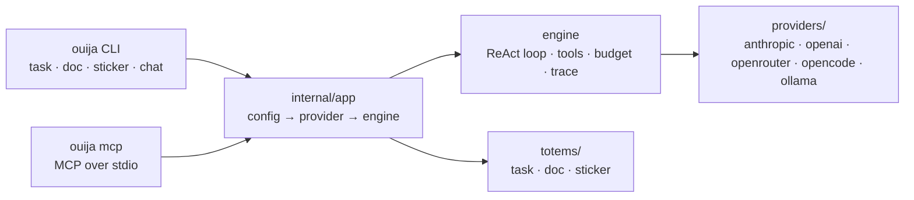

<p align="center">
  
</p>

<p align="center">
  <a href="https://github.com/discorgento/ouija/actions/workflows/ci.yml"></a>
  <a href="https://github.com/discorgento/ouija/releases"></a>
  <a href="https://go.dev/"></a>
  <a href="LICENSE"></a>
</p>

# ouija

A multi-totem AI harness that is **generic across projects and across LLMs**. A
shared engine — provider adapters, sandboxed file tools, budget enforcement,
tracing, structured logging, automatic provider fallback — reused by every totem
and by the interactive chat TUI.

> **A totem is an agent written in compiled Go code**, not YAML or Markdown. You get types, unit tests and golden files for the flow itself, while the engine enforces the cost budget, traces every step to Perfetto, sandboxes every tool call and exposes the agent over MCP. Reconciliation and retry are ordinary `for` loops — not instructions a model may or may not follow.

The metaphor is literal: a ouija board needs **several hands** reaching a
consensus to spell out an answer — exactly the *self-consistency* of the N
independent passes + reconcile in the `task` totem.



The engine knows nothing about tasks or documents — every totem defines its own
flow on top. See [Architecture](docs/explanation/architecture.md).

### Totems you own

The engine is **not locked away in `internal/`**. The `engine`, `registry` and
`schema` packages are public Go modules, so you can write a totem in *your own
repository*, build it into *your own binary*, and still get the full engine —
budget, trace, sandbox and MCP — for free:

```go
// github.com/you/your-agents/totems/sentinel/sentinel.go
package sentinel

import (
    "context"
    "github.com/discorgento/ouija/engine"
    "github.com/discorgento/ouija/registry"
)

type Totem struct{}

func (t *Totem) Name() string    { return "sentinel" }
func (t *Totem) Summary() string { return "Example external totem" }
func (t *Totem) Init(context.Context, *engine.Engine, *engine.Config) error { return nil }
func (t *Totem) Run(ctx context.Context, eng *engine.Engine, args registry.Args) (any, error) {
    res, err := eng.Run(ctx, engine.RunRequest{Label: "sentinel", Prompt: args.Task})
    if err != nil {
        return nil, err
    }
    return map[string]string{"summary": res.Text}, nil
}
func (t *Totem) Cleanup() error { return nil }

func init() { registry.Register(&Totem{}) }
```

`go build ./cmd/totem` produces a standalone binary with your totem and the
full engine behind it. No fork, no upstream rebuild. Walkthrough:
[Add a totem](docs/how-to/add-totem.md).

---

## Quick start

```sh
git clone https://github.com/discorgento/ouija.git
cd ouija
make install        # builds ouija + ouija-mcp into $GOBIN
ouija setup         # API keys + default provider/model (~/.config/ouija/config.json, 0600)
```

Then, inside any project:

```sh
cd /path/to/your/project
ouija task "your task here"
```

`ouija setup` walks you through the keys; pick `ollama` to run fully local and
free. Diagnose anything with `ouija doctor`.

## Commands

| Command | What it does |
|---|---|
| `ouija task "..."` | Verified implementation plan: scout → N passes → reconcile → checklist |
| `ouija doc "..."` | Code-verified client document — HTML + PDF + technical MD |
| `ouija sticker` | Laptop sticker SVG from real project metrics |
| `ouija chat` | Interactive terminal chat (Bubble Tea TUI): tools, streaming, approvals |
| `ouija setup` / `ouija init` | Global defaults / per-project config |
| `ouija learn "fact"` | Save project knowledge, injected into every prompt |
| `ouija mcp [install\|status]` | Serve MCP over stdio, or register ouija with your editor's harness |
| `ouija generate totem` | Scaffold a new totem |
| `ouija doctor` | Diagnose config, provider key, and harness wiring |

Flags, slash commands, shortcuts and exit codes:
[CLI reference](docs/reference/cli.md).

## Install

From a checkout:

```sh
make install        # both binaries → $GOBIN
```

Without `make`: `go install ./cmd/ouija` (and `./cmd/ouija-mcp`). Both land in
`$(go env GOBIN)` — or `$(go env GOPATH)/bin` when `GOBIN` is unset — which must
be on your `PATH`. Full details, including `PATH` per shell and the
`@latest` caveat: [Install](docs/how-to/install.md).

### Requirements

- **Go 1.26+** (uses `iter.Seq2`, `log/slog`, `slices`, `errors.Join`, `clear`,
  `range-over-int`). Runtime dependencies live in `go.mod` — the Charm stack
  (Bubble Tea v2, Bubbles, Lip Gloss, Glamour, Huh), `mvdan.cc/sh/v3`,
  `charmbracelet/x/ansi`, `atotto/clipboard`, `golang.org/x/sync`; everything
  else is the standard library.
- At least one provider configured via `ouija setup`.

## Development

```sh
make build          # ./ouija + ./ouija-mcp (gitignored)
make run ARGS='…'   # build + execute
make check          # gofmt + go vet + go test — run before committing
make help           # every target
make dist           # cross-compile 5 targets → dist/*.tar.gz
```

The version comes from the **git tag** — created automatically by the release
pipeline — and is injected at link time, feeding the CLI, the MCP `serverInfo`
and the TUI header from one source. Never edit a version by hand; pass an
explicit one only for testing (`make build VERSION=vX.Y.Z`).

CI runs the same gate on every push and PR (gofmt, vet, `go test -race ./...`,
build). Full workflow and code conventions:
[Contribute](docs/how-to/contribute.md).

Releases are automated: pushing to `main` opens a *release PR* (version bump +
changelog), merging it creates the tag `vX.Y.Z` and the GitHub Release with the
cross-compiled archives attached — no manual versioning, ever. Details:
[Releases](docs/how-to/contribute.md#releases).

## Documentation

Full documentation in [`docs/`](docs/index.md):

| Tutorial | How-to | Reference | Explanation |
|---|---|---|---|
| [Getting started](docs/tutorial/getting-started.md) | [Install](docs/how-to/install.md) | [CLI](docs/reference/cli.md) | [Architecture](docs/explanation/architecture.md) |
| | [Configure](docs/how-to/configure.md) | [Config schema](docs/reference/config-schema.md) | [Engine](docs/explanation/engine.md) |
| | [Run a totem](docs/how-to/run-totems.md) | [Environment](docs/reference/environment.md) | [Security](docs/explanation/security.md) |
| | [Chat TUI](docs/how-to/chat.md) | [Trace schema](docs/reference/trace-schema.md) | |
| | [MCP](docs/how-to/integrate-mcp.md) | | |
| | [Add a totem](docs/how-to/add-totem.md) | | |
| | [Add a provider](docs/how-to/add-provider.md) | | |
| | [Contribute](docs/how-to/contribute.md) | | |

## Using ouija from other tools

Any agentic CLI can run `ouija task "..."` as a shell command. For MCP-capable
harnesses (OpenCode, Claude Code, Cursor):

```sh
ouija mcp install   # detect harnesses and register ouija
ouija mcp status    # show where ouija is connected
```

Tools appear as `ouija_task`, `ouija_doc`, …, plus sandboxed resources via
`ouija://project/{path}`. Details: [MCP integration](docs/how-to/integrate-mcp.md).

## Security

Layered defenses — filesystem sandbox, protected paths, permission levels,
bash denylist/allowlist, doom-loop detection, budget ceilings, environment
sanitization — all **fail closed**: an inconclusive check means *deny*.

- Model and rationale: [Security model](docs/explanation/security.md)
- Vulnerability reporting: [SECURITY.md](SECURITY.md)

## Roadmap

- `review` totem (review the current git diff).
- `deploy` totem (preview + apply changes).
- Adversarial verification step (a skeptic refutes each finding before reconcile).

## Known limitations (honest debts)

- Sliding window drops old messages instead of summarizing; `maxUSD` only
  enforces when cost pricing is set; doom-loop detection is input-fingerprint
  exact; MCP resources are read-only. Details:
  [Engine → Known limitations](docs/explanation/engine.md#known-limitations-honest-debts).

## License

[MIT](LICENSE) — © 2026 [discorgento](https://discorgento.com/).

Contributions welcome — see [CONTRIBUTING.md](CONTRIBUTING.md). Changelog:
[CHANGELOG.md](CHANGELOG.md).
