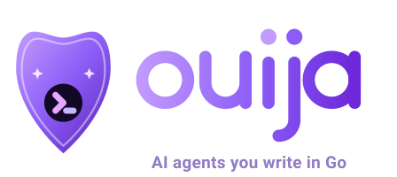
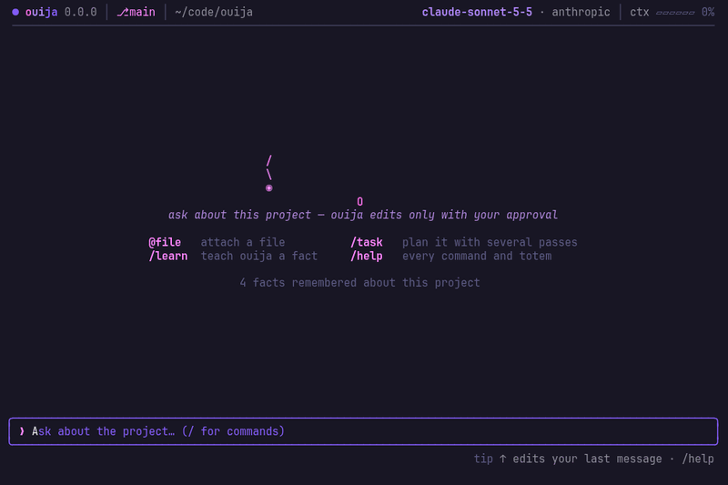
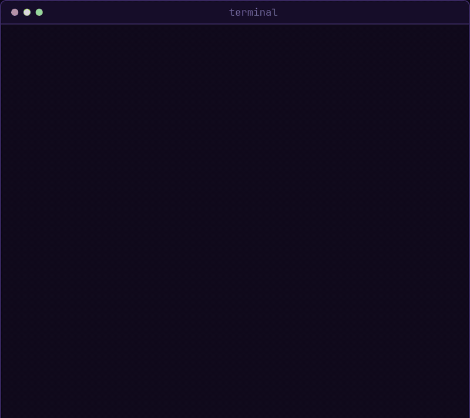
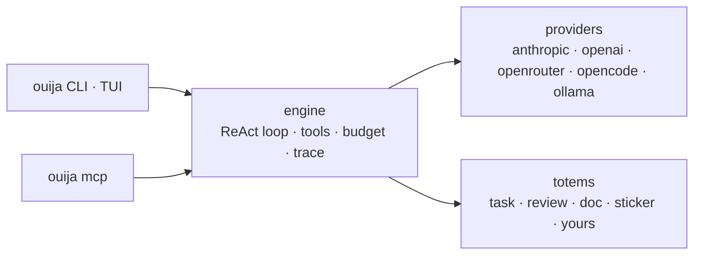
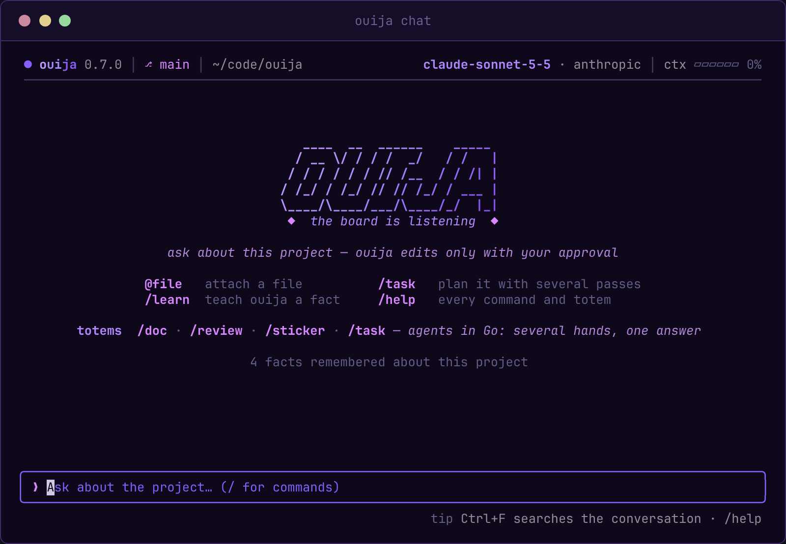
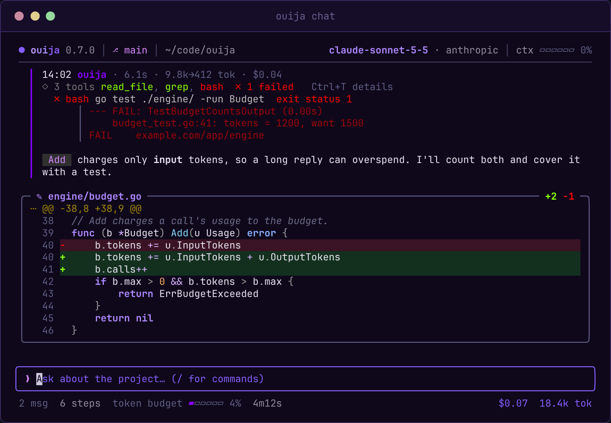
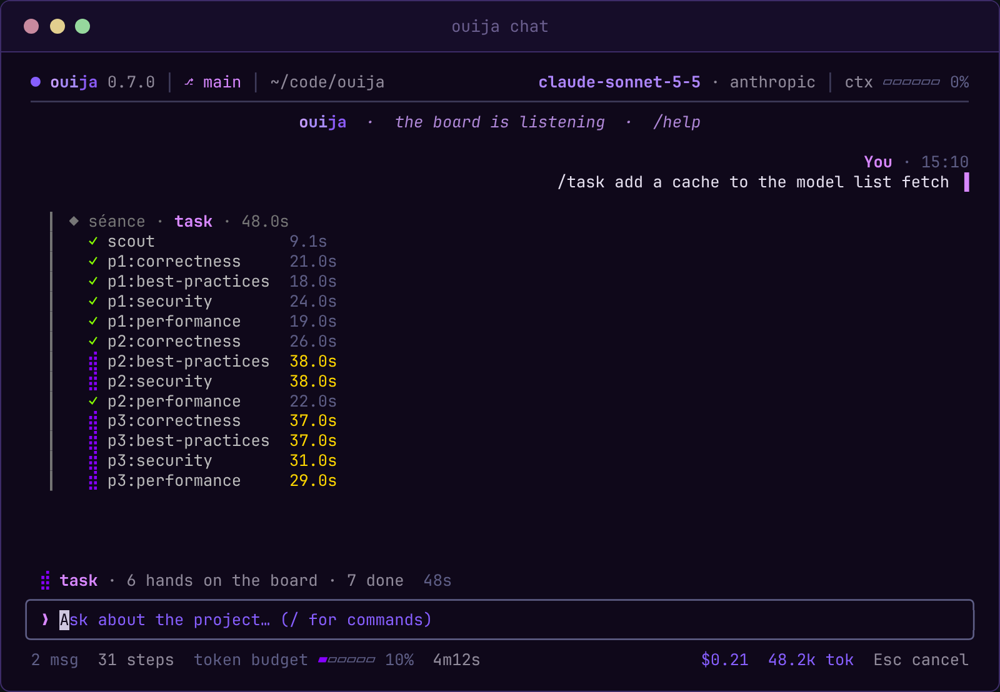

<p align="center">
  
</p>

<p align="center">
  <strong>Write your coding agents in Go. Run them safely with any model, even free local ones.</strong>
</p>

<p align="center">
  <a href="https://github.com/discorgento/ouija/releases"></a>
  <a href="https://github.com/discorgento/ouija/actions/workflows/ci.yml"></a>
  <a href="https://go.dev/"></a>
  <a href="LICENSE"></a>
</p>

<p align="center">
  <a href="#quick-start">Quick start</a> ·
  <a href="#the-chat">The chat</a> ·
  <a href="#write-your-own-agent">Write your own agent</a> ·
  <a href="#safe-by-default">Security</a> ·
  <a href="docs/index.md">Docs</a>
</p>

<p align="center">
  
</p>

```sh
curl -fsSL https://raw.githubusercontent.com/discorgento/ouija/main/scripts/install.sh | sh
```

- **Agents as code**: each step is a line of Go the model cannot skip, with
  types, tests and golden files; the model only makes the judgment calls.
- **Sandboxed by default**: commands run with no network and no reads outside
  the project (Landlock and seccomp on Linux, Seatbelt on macOS), and every
  edit waits for your approval.
- **Any model**: Anthropic, OpenAI, OpenRouter (free models too), OpenCode, or
  Ollama on your own machine.
- **A chat that shows its work**: every tool, diff, token and cent on screen.
- **Plugs into your editor**: the agents become tools in Claude Code, Cursor
  and OpenCode through MCP.

## Quick start

One command installs ouija, no Go needed:

```sh
curl -fsSL https://raw.githubusercontent.com/discorgento/ouija/main/scripts/install.sh | sh   # Linux, macOS
irm https://raw.githubusercontent.com/discorgento/ouija/main/scripts/install.ps1 | iex       # Windows
```

<p align="center">
  
</p>

It offers to add ouija to your `PATH` and opens the setup: pick a provider,
paste its key (checked right away) and pick a model, or pick Ollama or
`openrouter/free` to start for free. Then, inside any project:

```sh
cd /path/to/your/project
ouija                      # the chat: explore and edit code, approve diffs
ouija task "describe X"    # one-shot: verified plan (scout → N passes → reconcile)
```

If something does not work, run `ouija doctor`.

## Why ouija

Written as prose, "Do A, then verify B, then reconcile" is a request the model
may skip. Written in Go, each step is the next line of code, and you can test
it. [The full argument →](docs/explanation/totems.md)

The name fits: a ouija board needs several hands to spell an answer, and the
`task` totem sends several independent passes over the code, then reconciles
what they found into one answer.



A shared engine runs the model, the tools, the sandbox, the budget and the
trace; each totem defines only its own flow on top of it.
[Architecture →](docs/explanation/architecture.md)

**When not to use it:** if you want a finished coding agent and never plan to
write one, a general-purpose agent fits better; ouija's chat is there, but its
strength is the agents you write. On Windows, and on Linux kernels without
Landlock ABI v9, commands run without the OS sandbox and ask before each one.

## The chat

<p align="center">
  
</p>

Each reply shows what it did. One line lists the tools the turn used (a failed
command also shows its last lines of output), followed by the time, tokens and
cost. Every file change appears as a diff, and nothing is written until you
approve it.

<p align="center">
  
</p>

You can run the totems inside the chat. `/task "add a cache"` shows each step
of the `task` totem live: the scout that surveys the code, every independent
pass, and the reconcile step that merges them. It ends with the plan.

<p align="center">
  
</p>

On a wide terminal, a change shows side by side, syntax-highlighted. `@file`
attaches a file, `/undo` reverts a change, `Ctrl+F` searches, and
`ouija chat -c` resumes the last conversation.

Keys, commands and themes: [Chat TUI](docs/how-to/chat.md).

## Commands

| Command | What it does |
|---|---|
| `ouija` / `ouija chat` | The terminal chat: tools, streaming, approvals |
| `ouija task "..."` | Verified implementation plan: scout → N passes → reconcile → checklist |
| `ouija review` | Review the branch's changes: find problems → a skeptic verifies each → what holds |
| `ouija doc "..."` | Code-verified client document — HTML + PDF + technical MD |
| `ouija sticker` | Laptop sticker SVG from real project metrics |
| `ouija setup` / `ouija init` | Global defaults / per-project config |
| `ouija trust` | Apply a project config you did not write (permissions, allowlist, apiKey, provider/model, budget, rules, …) |
| `ouija learn "fact"` | Save project knowledge, used by the chat and the `task` totem |
| `ouija mcp [install\|status]` | Serve MCP over stdio, or register ouija with your editor's harness |
| `ouija generate totem` | Scaffold a new totem |
| `ouija doctor` | Diagnose config, provider key, sandbox and harness wiring |

Flags, slash commands, shortcuts and exit codes:
[CLI reference](docs/reference/cli.md).

## Write your own agent

A totem is a Go type in **your** repository. `engine`, `registry`, `schema` and
`bootstrap` are public Go packages, so you neither fork ouija nor rebuild it,
and your agent inherits the budget, sandbox, tracing and MCP export.

The design splits the work in two. **Go decides the path**: which steps run, in
what order, with which data, and what happens to each answer. **The model only
makes the judgment calls.** Each call tells it how to work (`System`), gives it
this call's data (`Prompt`), lets it read files (`UseTools`) and fixes the shape
of its answer (`Schema`).

Here is a code reviewer in about 50 lines. It trims down the built-in
[`review`](totems/review/review.go) totem, which adds typed inputs, parallel
verification passes, a terminal summary and tests:

```go
// github.com/you/your-agents/totems/review/review.go — the whole agent
package review

import (
    "context"
    "encoding/json"
    "os/exec"

    "github.com/discorgento/ouija/engine"
    "github.com/discorgento/ouija/registry"
    "github.com/discorgento/ouija/schema"
)

type Totem struct{}

func (t *Totem) Name() string    { return "review" }
func (t *Totem) Summary() string { return "Review the branch: find problems, verify each one" }

func (t *Totem) Run(ctx context.Context, eng *engine.Engine, args registry.Args) (any, error) {
    // 1. Go gathers the context — what changed since main. Nothing to guess.
    cmd := exec.CommandContext(ctx, "git", "diff", "--no-ext-diff", "--merge-base", "main")
    cmd.Dir = eng.Config().ProjectRoot
    diff, err := cmd.Output()
    if err != nil {
        return nil, err
    }

    // 2. The model judges. System: how to work. Prompt: this call's data.
    //    UseTools: it may open files. Schema: the shape the answer must have.
    found, err := eng.Run(ctx, engine.RunRequest{
        Label:    "find",
        System:   "You review code changes. Report real bugs only, never style.",
        Prompt:   "Focus: " + args.Task + "\n\nDIFF:\n" + string(diff),
        UseTools: true,
        Schema:   schema.Obj(map[string]any{"findings": schema.Arr("one problem each: file, line, why")}, "findings"),
    })
    if err != nil {
        return nil, err
    }
    var out struct{ Findings []string }
    if err := json.Unmarshal([]byte(found.Text), &out); err != nil {
        return nil, err
    }

    // 3. A rule in Go, not a request in a prompt: a skeptic checks every
    //    finding, and only the confirmed ones are kept.
    var confirmed []string
    for _, f := range out.Findings {
        v, err := eng.Run(ctx, engine.RunRequest{
            Label:    "verify",
            System:   "You are a skeptic. Read the code; say yes only if the problem is real.",
            Prompt:   f,
            UseTools: true,
            Schema:   schema.Obj(map[string]any{"real": schema.Enum("is it real", "yes", "no")}, "real"),
        })
        var verdict struct{ Real string }
        if err == nil && json.Unmarshal([]byte(v.Text), &verdict) == nil && verdict.Real == "yes" {
            confirmed = append(confirmed, f)
        }
    }
    return map[string]any{"confirmed": confirmed}, nil
}

func init() { registry.Register(&Totem{}) }
```

`bootstrap.Main` is the whole host program. It provides the command line, the
MCP server, and the same config the ouija CLI reads: keys and the default
provider and model from the global `~/.config/ouija/config.json`, and the
budget, rules and other settings from the project's `.ouija/config.json`:

```go
// github.com/you/your-agents/cmd/my-totem/main.go — the whole host
package main

import (
    "os"

    "github.com/discorgento/ouija/bootstrap"
    _ "github.com/you/your-agents/totems/review"
)

func main() { os.Exit(bootstrap.Main(bootstrap.WithName("my-totem"))) }
```

```sh
go build -o my-totem ./cmd/my-totem   # standalone binary, full engine behind it
my-totem review "concurrency"         # run it on the current branch
my-totem mcp                          # your totems as my-totem_<name> tools in
                                      # Claude Code, Cursor or OpenCode
```

Walkthrough: [Add a totem](docs/how-to/add-totem.md) · Design rationale:
[Totems](docs/explanation/totems.md).

## Safe by default

Every layer **fails closed**: when a check is inconclusive, the answer is
*deny*.

- **OS sandbox for every command**: Landlock and a seccomp filter on Linux,
  Seatbelt on macOS. Writes only inside the project, no network unless the
  project opens a port, no reading other processes, and background jobs end
  with the command.
- **Secrets stay out**: `.env`, keys, credentials and other protected files are
  refused to every file tool and to commands that name them, and credentials
  are stripped from every command's environment.
- **You approve every change**: edits, deletes and commands wait for you, and
  the prompt shows the exact file or command.
- **Untrusted repositories cannot reconfigure ouija**: a project's config
  applies its sensitive keys only after `ouija trust`.
- **Budget ceilings and loop detection** stop a run that goes nowhere.

[Security model](docs/explanation/security.md) ·
[Report a vulnerability](SECURITY.md)

## Use it from your editor

Any coding agent that can run shell commands can run `ouija task "..."`. For
harnesses that speak MCP (Claude Code, Cursor, OpenCode), register ouija once:

```sh
ouija mcp install   # detect harnesses and register ouija
ouija mcp status    # show where ouija is connected
```

The totems then appear as tools named `ouija_task`, `ouija_doc`, …, and project
files are readable, inside the sandbox, as `ouija://project/{path}` resources.
[MCP integration →](docs/how-to/integrate-mcp.md)

## Install

The [Quick start](#quick-start) installer needs nothing else. To build from a
checkout instead, with **Go 1.26+**:

```sh
make install        # both binaries → $GOBIN
```

Without `make`, run `go install ./cmd/ouija` (and `./cmd/ouija-mcp`). Both
binaries land in `$(go env GOBIN)`, or in `$(go env GOPATH)/bin` when `GOBIN` is
unset, and that directory must be on your `PATH`. [Install](docs/how-to/install.md)
covers the details, including `PATH` for each shell and how the installer
verifies what it downloads.

## Documentation

Full documentation in [`docs/`](docs/index.md):

| Tutorial | How-to | Reference | Explanation |
|---|---|---|---|
| [Getting started](docs/tutorial/getting-started.md) | [Install](docs/how-to/install.md) | [CLI](docs/reference/cli.md) | [Totems](docs/explanation/totems.md) |
| | [Configure](docs/how-to/configure.md) | [Config schema](docs/reference/config-schema.md) | [Architecture](docs/explanation/architecture.md) |
| | [Run a totem](docs/how-to/run-totems.md) | [Environment](docs/reference/environment.md) | [Engine](docs/explanation/engine.md) |
| | [Chat TUI](docs/how-to/chat.md) | [Trace schema](docs/reference/trace-schema.md) | [Security](docs/explanation/security.md) |
| | [MCP](docs/how-to/integrate-mcp.md) | | |
| | [Add a totem](docs/how-to/add-totem.md) | | |
| | [Add a provider](docs/how-to/add-provider.md) | | |
| | [Contribute](docs/how-to/contribute.md) | | |

## Roadmap

- `deploy` totem (preview + apply changes).
- Totem registry — index and install third-party totems
  (`ouija totem add github.com/…`).
- A domain allowlist for the sandbox's network, instead of ports.

## Known limitations

- When the conversation outgrows the context window, old messages are dropped,
  not summarized.
- `maxUSD` is enforced only when cost pricing is set.
- Doom-loop detection catches only calls whose input is exactly identical.
- MCP resources are read-only.

[Engine → Known limitations](docs/explanation/engine.md#known-limitations-honest-debts)

## Contributing

`make check` runs gofmt, vet and the tests; CI adds staticcheck, actionlint,
the race detector, three OSes and govulncheck. Releases are automated from
Conventional Commits. [CONTRIBUTING.md](CONTRIBUTING.md) ·
[Contribute guide](docs/how-to/contribute.md) · [Changelog](CHANGELOG.md)

### Contributors

<a href="https://github.com/discorgento/ouija/graphs/contributors">
  
</a>

## License

[MIT](LICENSE) — © 2026 [discorgento](https://discorgento.com/).
