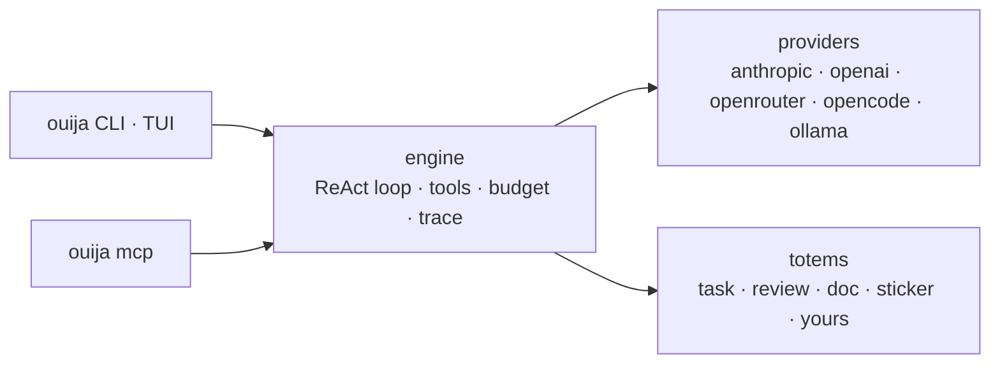

<p align="center">
  
</p>

<p align="center">
  <a href="https://github.com/discorgento/ouija/actions/workflows/ci.yml"></a>
  <a href="https://github.com/discorgento/ouija/releases"></a>
  <a href="https://go.dev/"></a>
  <a href="LICENSE"></a>
</p>

# ouija

ouija is a harness for AI agents that you write in Go: it runs a model in a loop
and executes the tool calls the model asks for. Each agent, called a **totem**,
is real code you own, with types, tests and golden files instead of a prompt
file. Underneath, a shared engine handles model providers, the filesystem
sandbox, the cost budget, tracing and MCP export (MCP, the Model Context
Protocol, lets editors such as Claude Code or Cursor call outside tools).

<p align="center">
  
</p>

> **Why not a prompt file?** Written as prose, "Do A, then verify B, then
> reconcile" is a request the model may skip. Written in Go, each step is the
> next line of code, and you can test it.
> [The full argument →](docs/explanation/totems.md)

ouija ships with four totems: `task`, `review`, `doc` and `sticker`. The engine
is also a Go library, so **your own agent is a Go type in your repo** (the code
reviewer below is about 50 lines), and it inherits the budget, sandbox, tracing and MCP export. `go build`
turns it into a standalone binary.
[Write your own agent →](#write-your-own-agent)

The name fits: a ouija board needs several hands to spell an answer, and the
`task` totem sends several independent passes over the code, then reconciles
what they found into one answer.



The engine knows nothing about tasks or documents; each totem defines its own
flow on top of it. See [Architecture](docs/explanation/architecture.md).

## Quick start

```sh
git clone https://github.com/discorgento/ouija.git
cd ouija
make install        # builds ouija + ouija-mcp into $GOBIN
ouija setup         # API keys + default provider/model (~/.config/ouija/config.json, 0600)
```

Then, inside any project:

```sh
cd /path/to/your/project
ouija chat                 # daily driver: explore and edit code, approve diffs
ouija task "describe X"    # one-shot: verified plan (scout → N passes → reconcile)
```

`ouija setup` walks you through the keys; pick `ollama` to run locally and
for free. If something does not work, run `ouija doctor`. In a terminal,
`ouija` with no arguments opens the chat, and runs the setup first if you have
not run it yet.

## The chat

<p align="center">
  
</p>

Each reply shows what it did. One line lists the tools the turn used (a failed
command also shows its last lines of output), followed by the time, tokens and
cost. Every file change appears as a diff, side by side on a wide terminal.
`@file` attaches a file, `/undo` reverts a change, `Ctrl+F` searches, and
`ouija chat -c` resumes the last conversation.

<p align="center">
  
</p>

You can run the totems inside the chat. `/task "add a cache"` shows each step
of the `task` totem live: the scout that surveys the code, every independent
pass, and the reconcile step that merges them. It ends with the plan.

<p align="center">
  
</p>

<p align="center">
  
</p>

Keys, commands and themes: [Chat TUI](docs/how-to/chat.md) ·
[CLI reference](docs/reference/cli.md).

## Commands

| Command | What it does |
|---|---|
| `ouija task "..."` | Verified implementation plan: scout → N passes → reconcile → checklist |
| `ouija review` | Review the branch's changes: find problems → a skeptic verifies each → what holds |
| `ouija doc "..."` | Code-verified client document — HTML + PDF + technical MD |
| `ouija sticker` | Laptop sticker SVG from real project metrics |
| `ouija chat` | Interactive terminal chat (Bubble Tea TUI): tools, streaming, approvals |
| `ouija setup` / `ouija init` | Global defaults / per-project config |
| `ouija trust` | Apply a project config you did not write (permissions, allowlist, apiKey, systemPrompt, projectRoot) |
| `ouija learn "fact"` | Save project knowledge, used by the chat and the `task` totem |
| `ouija mcp [install\|status]` | Serve MCP over stdio, or register ouija with your editor's harness |
| `ouija generate totem` | Scaffold a new totem |
| `ouija doctor` | Diagnose config, provider key, and harness wiring |
| `ouija config` | Same wizard as `ouija setup` |
| `ouija version` | Print the version |

Flags, slash commands, shortcuts and exit codes:
[CLI reference](docs/reference/cli.md).

## Write your own agent

A totem is a Go type in **your** repository. `engine`, `registry`, `schema` and
`bootstrap` are public Go packages, so you neither fork ouija nor rebuild it.

The design splits the work in two. **Go decides the path**: which steps run, in
what order, with which data, and what happens to each answer. **The model only
makes the judgment calls.** Each call tells it how to work (`System`), gives it
this call's data (`Prompt`), lets it read files (`UseTools`) and fixes the shape
of its answer (`Schema`).

Here is a code reviewer in about 50 lines. It trims down the built-in
[`review`](totems/review/review.go) totem, which adds typed inputs, parallel
verification passes, a terminal summary and tests:

```go
// github.com/you/your-agents/totems/review/review.go — the whole agent
package review

import (
    "context"
    "encoding/json"
    "os/exec"

    "github.com/discorgento/ouija/engine"
    "github.com/discorgento/ouija/registry"
    "github.com/discorgento/ouija/schema"
)

type Totem struct{}

func (t *Totem) Name() string    { return "review" }
func (t *Totem) Summary() string { return "Review the branch: find problems, verify each one" }

func (t *Totem) Run(ctx context.Context, eng *engine.Engine, args registry.Args) (any, error) {
    // 1. Go gathers the context — what changed since main. Nothing to guess.
    cmd := exec.CommandContext(ctx, "git", "diff", "--no-ext-diff", "--merge-base", "main")
    cmd.Dir = eng.Config().ProjectRoot
    diff, err := cmd.Output()
    if err != nil {
        return nil, err
    }

    // 2. The model judges. System: how to work. Prompt: this call's data.
    //    UseTools: it may open files. Schema: the shape the answer must have.
    found, err := eng.Run(ctx, engine.RunRequest{
        Label:    "find",
        System:   "You review code changes. Report real bugs only, never style.",
        Prompt:   "Focus: " + args.Task + "\n\nDIFF:\n" + string(diff),
        UseTools: true,
        Schema:   schema.Obj(map[string]any{"findings": schema.Arr("one problem each: file, line, why")}, "findings"),
    })
    if err != nil {
        return nil, err
    }
    var out struct{ Findings []string }
    if err := json.Unmarshal([]byte(found.Text), &out); err != nil {
        return nil, err
    }

    // 3. A rule in Go, not a request in a prompt: a skeptic checks every
    //    finding, and only the confirmed ones are kept.
    var confirmed []string
    for _, f := range out.Findings {
        v, err := eng.Run(ctx, engine.RunRequest{
            Label:    "verify",
            System:   "You are a skeptic. Read the code; say yes only if the problem is real.",
            Prompt:   f,
            UseTools: true,
            Schema:   schema.Obj(map[string]any{"real": schema.Enum("is it real", "yes", "no")}, "real"),
        })
        var verdict struct{ Real string }
        if err == nil && json.Unmarshal([]byte(v.Text), &verdict) == nil && verdict.Real == "yes" {
            confirmed = append(confirmed, f)
        }
    }
    return map[string]any{"confirmed": confirmed}, nil
}

func init() { registry.Register(&Totem{}) }
```

`bootstrap.Main` is the whole host program. It provides the command line, the
MCP server, and the same config the ouija CLI reads: keys and the default
provider and model from the global `~/.config/ouija/config.json`, and the
budget, rules and other settings from the project's `.ouija/config.json`:

```go
// github.com/you/your-agents/cmd/my-totem/main.go — the whole host
package main

import (
    "os"

    "github.com/discorgento/ouija/bootstrap"
    _ "github.com/you/your-agents/totems/review"
)

func main() { os.Exit(bootstrap.Main(bootstrap.WithName("my-totem"))) }
```

```sh
go build -o my-totem ./cmd/my-totem   # standalone binary, full engine behind it
my-totem review "concurrency"         # run it on the current branch
my-totem mcp                          # your totems as my-totem_<name> tools in
                                      # Claude Code, Cursor or OpenCode
```

Walkthrough: [Add a totem](docs/how-to/add-totem.md) · Design rationale:
[Totems](docs/explanation/totems.md).

## Install

A release, no Go needed:

```sh
curl -fsSL https://raw.githubusercontent.com/discorgento/ouija/main/scripts/install.sh | sh       # Linux, macOS
irm https://raw.githubusercontent.com/discorgento/ouija/main/scripts/install.ps1 | iex           # Windows (PowerShell)
```

From a checkout:

```sh
make install        # both binaries → $GOBIN
```

Without `make`, run `go install ./cmd/ouija` (and `./cmd/ouija-mcp`). Both
binaries land in `$(go env GOBIN)`, or in `$(go env GOPATH)/bin` when `GOBIN` is
unset, and that directory must be on your `PATH`. [Install](docs/how-to/install.md)
covers the details, including `PATH` for each shell and the `@latest` caveat.

### Requirements

- **Go 1.26+** (uses `iter.Seq2`, `log/slog`, `slices`, `errors.Join`, `clear`,
  `range-over-int`). Runtime dependencies live in `go.mod` — the Charm stack
  (Bubble Tea v2, Bubbles, Lip Gloss, Glamour, Huh), `mvdan.cc/sh/v3`,
  `charmbracelet/x/ansi`, `atotto/clipboard`, `golang.org/x/sync`; everything
  else is the standard library.
- At least one provider configured via `ouija setup`.

## Development

```sh
make build          # ./ouija + ./ouija-mcp (gitignored)
make run ARGS='…'   # build + execute
make check          # gofmt + go vet + go test — run before committing
make help           # every target
make dist           # cross-compile 5 targets → dist/ouija_<version>_<os>_<arch> archives
```

The version comes from the **git tag**, which the release pipeline creates.
The build injects it at link time, so the CLI, the MCP `serverInfo` and the TUI
header all read it from one source. Never edit a version by hand; pass one
explicitly only for testing (`make build VERSION=vX.Y.Z`).

CI runs the same checks on every push and pull request (gofmt, vet,
`go test -race ./...`, build). [Contribute](docs/how-to/contribute.md) covers the
full workflow and the code conventions.

Releases are automated. A push to `main` opens a *release PR* that bumps the
version and updates the changelog. Merging that PR creates the tag `vX.Y.Z` and
a GitHub Release with the cross-compiled archives attached, so nobody ever sets
a version by hand. Details: [Releases](docs/how-to/contribute.md#releases).

## Documentation

Full documentation in [`docs/`](docs/index.md):

| Tutorial | How-to | Reference | Explanation |
|---|---|---|---|
| [Getting started](docs/tutorial/getting-started.md) | [Install](docs/how-to/install.md) | [CLI](docs/reference/cli.md) | [Totems](docs/explanation/totems.md) |
| | [Configure](docs/how-to/configure.md) | [Config schema](docs/reference/config-schema.md) | [Architecture](docs/explanation/architecture.md) |
| | [Run a totem](docs/how-to/run-totems.md) | [Environment](docs/reference/environment.md) | [Engine](docs/explanation/engine.md) |
| | [Chat TUI](docs/how-to/chat.md) | [Trace schema](docs/reference/trace-schema.md) | [Security](docs/explanation/security.md) |
| | [MCP](docs/how-to/integrate-mcp.md) | | |
| | [Add a totem](docs/how-to/add-totem.md) | | |
| | [Add a provider](docs/how-to/add-provider.md) | | |
| | [Contribute](docs/how-to/contribute.md) | | |

## Using ouija from other tools

Any coding agent that can run shell commands can run `ouija task "..."`. For
harnesses that speak MCP (OpenCode, Claude Code, Cursor), register ouija once:

```sh
ouija mcp install   # detect harnesses and register ouija
ouija mcp status    # show where ouija is connected
```

The totems then appear as tools named `ouija_task`, `ouija_doc`, …, and project
files are readable, inside the sandbox, as `ouija://project/{path}` resources.
Details: [MCP integration](docs/how-to/integrate-mcp.md).

## Security

ouija layers several defenses: a filesystem sandbox, protected paths,
permission levels, a bash denylist and allowlist, detection of an agent stuck
repeating the same call (a "doom loop"), budget ceilings, and credentials
stripped from the environment of every command it runs. All of them **fail closed**: when a check is inconclusive, the
answer is *deny*.

- Model and rationale: [Security model](docs/explanation/security.md)
- Vulnerability reporting: [SECURITY.md](SECURITY.md)

## Roadmap

- `deploy` totem (preview + apply changes).
- Adversarial verification step (a skeptic refutes each finding before reconcile).
- Totem registry — index and install third-party totems
  (`ouija totem add github.com/…`).

## Known limitations (honest debts)

- When the conversation outgrows the context window, old messages are dropped,
  not summarized.
- `maxUSD` is enforced only when cost pricing is set.
- Doom-loop detection catches only calls whose input is exactly identical.
- MCP resources are read-only.

Details:
[Engine → Known limitations](docs/explanation/engine.md#known-limitations-honest-debts).

## License

[MIT](LICENSE) — © 2026 [discorgento](https://discorgento.com/).

Contributions welcome — see [CONTRIBUTING.md](CONTRIBUTING.md). Changelog:
[CHANGELOG.md](CHANGELOG.md).
